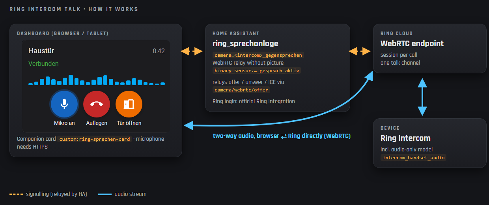
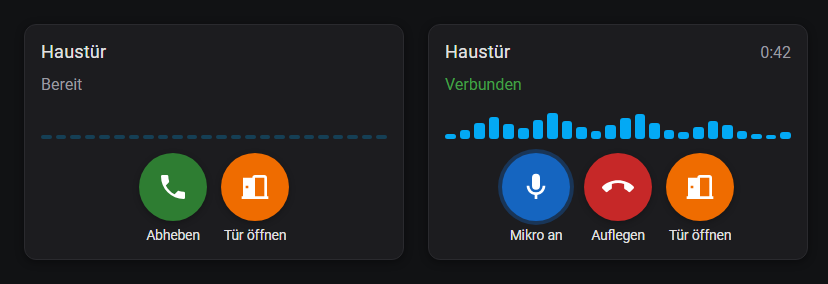

# Ring Intercom Talk for Home Assistant

Custom integration that enables **two-way talk with a Ring Intercom directly from a Home Assistant dashboard** –
including the audio-only model (`intercom_handset_audio`). The official Ring integration only provides ding and
door-unlock entities for the Intercom; this integration adds the missing talk path.


*How the talk path works: Home Assistant relays the WebRTC signalling, audio flows directly between browser and Ring*


*Companion card [Ring Intercom Talk Card](https://github.com/SysriX/ring_intercom_talk_ha_card): idle and during a call (UI in German)*

- Domain: `ring_sprechanlage` (German name kept for compatibility)
- Version: 0.1.0 – **experimental**
- Entity names are German ("Gegensprechen", "Gespräch aktiv")

> Built for the author's own home and still being tested with real calls. Ring does not document this interface;
> changes on Ring's side or in `python-ring-doorbell` can break it.

## How it works

The browser opens the WebRTC audio connection **directly with Ring**. Home Assistant only relays offer, answer and ICE
candidates through its camera WebRTC API (`camera/webrtc/offer`). That's why the integration creates a `camera` entity
without a picture – HA offers WebRTC signalling only for cameras. The Ring login is handled by the official Ring integration.

## Entities

Created for every Ring Intercom found in the loaded Ring config entries (retries for up to 15 minutes if Ring loads later):

| Entity | Description |
|---|---|
| `camera.<intercom>_gegensprechen` | WebRTC relay for talking (no image/snapshots), attribute `audio_only` |
| `binary_sensor.<intercom>_gesprach_aktiv` | On while a device is talking to the Intercom, attribute `sitzungen` (open sessions) |

The Intercom has a single talk channel – only one device (tablet or Ring app) can talk at a time.

## Requirements

- Home Assistant 2025.1 or newer with the official **Ring** integration set up
- **HTTPS** access to Home Assistant for the microphone (browsers block the mic on plain `http://`; listening still works)

## Installation

### HACS (custom repository)

1. HACS → ⋮ → **Custom repositories** → add `https://github.com/SysriX/ring_intercom_talk_ha_integration`, category **Integration**.
2. Install **Ring Intercom Talk** and restart Home Assistant.

### Manual

Copy `custom_components/ring_sprechanlage` to `/config/custom_components/ring_sprechanlage` and restart Home Assistant.

## Configuration

`configuration.yaml`:

```yaml
ring_sprechanlage:
  # video_anfordern: true   # testing only: also request video from Ring (like the Ring app does for video intercoms)
```

No config flow; YAML only.

### Debugging

Enable debug logging (until the next restart) with `logger.set_level`:
`custom_components.ring_sprechanlage: debug` and `ring_doorbell.webrtcstream: debug`.

## Companion card

[ring_intercom_talk_ha_card](https://github.com/SysriX/ring_intercom_talk_ha_card) (`custom:ring-sprechen-card`) –
microphone button (tap to toggle, hold to talk), optional door-open button, hangs up when the popup closes.

```yaml
type: custom:ring-sprechen-card
entity: camera.front_door_gegensprechen
gespraech_entity: binary_sensor.front_door_gesprach_aktiv
```

## Credits and license

Based on [cmos486/ring-intercom-video](https://github.com/cmos486/ring-intercom-video) (Apache License 2.0),
reduced to two-way talk and extended with support for the audio-only Intercom. See [NOTICE](NOTICE) and
[LICENSE](LICENSE). The whole repository is licensed under the Apache License 2.0.
